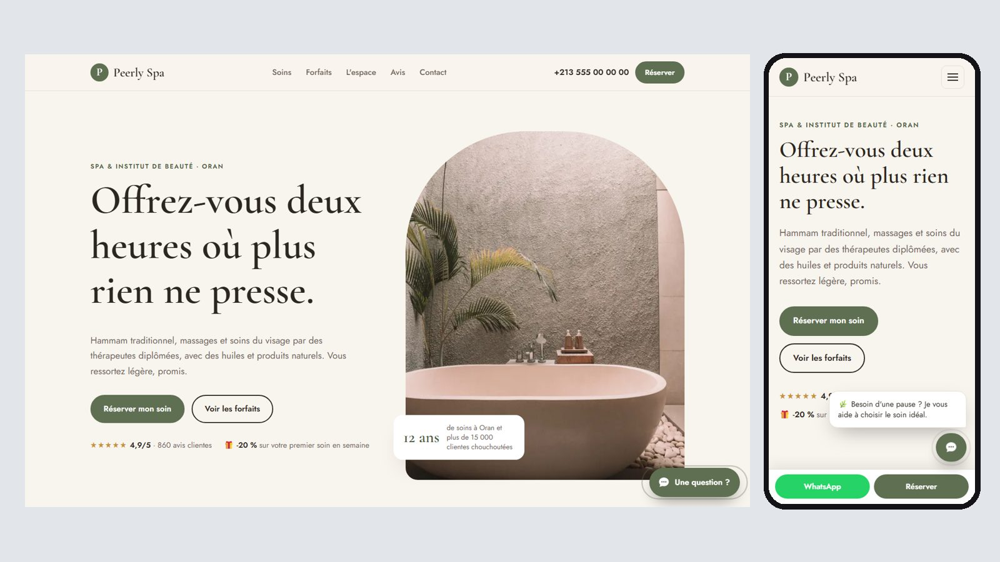

# Peerly Spa & Beauty: spa website

A conversion-focused website for a spa and beauty salon in Oran: treatments with prices, packages, a welcome offer, WhatsApp booking and an AI assistant that recommends the right treatment.

**Live demo:** https://abdelmoulabilel.github.io/SPA-website/



## Highlights

- **Built to convert:** one clear call to action per section, a sticky mobile bar (WhatsApp + book), a short booking form with inline validation, reviews, a limited offer, and an FAQ that answers objections before they stop a booking.
- **AI assistant:** a chat widget that answers visitors' questions 24/7 from the business facts in [`assistant.json`](assistant.json) and steers them toward booking. It runs on Claude through a small Cloudflare Worker ([site-assistant](https://github.com/AbdelmoulaBilel/site-assistant)); with no server configured it falls back to instant FAQ answers.
- **Fast:** plain HTML, CSS and JavaScript with no framework, Bootstrap or jQuery. Images are WebP, lazy-loaded and sized; all page assets together weigh under 1 MB (web fonts aside).
- **Responsive and accessible:** mobile-first layout, keyboard navigation, visible focus states, reduced-motion support, semantic HTML and schema.org data for search engines.
- **Language:** French (Algerian market, prices in DA).

## Run locally

```bash
python -m http.server 8080
# open http://localhost:8080
```

## Connect the AI assistant

1. Deploy the worker from [site-assistant](https://github.com/AbdelmoulaBilel/site-assistant).
2. In `index.html`, set `data-endpoint` on the `assistant.js` script tag to `https://<your-worker>.workers.dev/chat`.
3. Edit the facts, suggested questions and FAQ in `assistant.json`. The worker reads this file, so the site and the AI stay in sync.

## Project structure

```text
index.html            the page
assistant.json        business facts + chat UI text + offline FAQ
assets/css/base.css   shared design system (layout, buttons, forms)
assets/css/site.css   this site's theme
assets/js/main.js     navigation, scroll reveal, tabs, booking form
assets/js/assistant.js  chat widget
```

## Before / after

This is a 2026 rebuild of a 2023 Bootstrap template project. The original version is kept on the [`legacy-2023`](../../tree/legacy-2023) branch.

> Concept site for a fictional business: names, prices, reviews and phone numbers are placeholders.

Design and development by [Bilel Abdelmoula](https://github.com/AbdelmoulaBilel).
